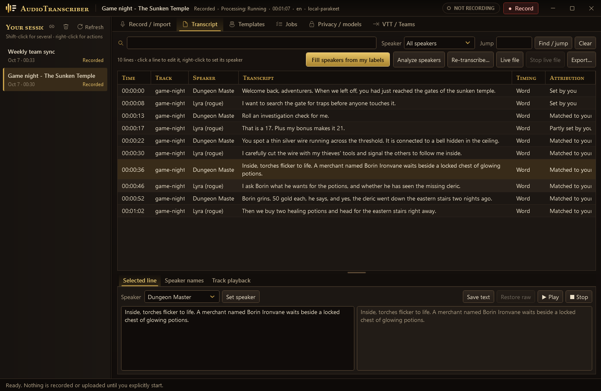

# AudioTranscriber Wiki

**Status:** Implemented
**Last Updated:** 2026-11-14
**Audience:** Users and contributors
**Last verified:** 2026-11-14 against b3ed981
**Code:** `src/AudioTranscriber.App`, `src/AudioTranscriber.Application`, `installer`

AudioTranscriber is a native Windows and Linux x64 desktop app for recording, importing,
transcribing, searching, and exporting durable transcripts. It records the selected
output device (WASAPI on Windows, PulseAudio/PipeWire on Linux), can keep a separately timestamped microphone track, and keeps
original audio on disk so slow inference or a network problem does not erase the
recording.

It works locally by default with Parakeet TDT v3, speaker analysis, searchable
transcripts, corrections, playback, exports, WebVTT import, and optional output
templates powered by OpenAI-compatible LLMs. NVIDIA cloud
routes are opt-in per session.

Latest release: get the Windows setup `.exe`, a Linux `.deb`/`.rpm`, or the portable
`.zip`/`.tar.gz` from [the latest release](https://github.com/throndir2/AudioTranscriber/releases/latest)
(see [Installing](Installing-AudioTranscriber.md)). Releases are unsigned and update
themselves from GitHub.

## Start here

- New user: [Installing](Installing-AudioTranscriber.md) → [First Steps](First-Steps.md) → [Recording and Importing](Recording-and-Importing.md)
- Working with a transcript: [Transcripts and Search](Transcripts-and-Search.md) → [Speakers and Voice Library](Speakers-and-Voice-Library.md) → [Managing Sessions](Managing-Sessions.md)
- Cloud or model choices: [Transcription Providers](Transcription-Providers.md) and [Privacy and Uploads](Privacy-and-Uploads.md)

## Using AudioTranscriber

| Page | What it helps with |
| --- | --- |
| [Installing](Installing-AudioTranscriber.md) | Windows installer, Linux packages, portable downloads and prerequisites. |
| [First Steps](First-Steps.md) | The default first recording: output, microphone, local Parakeet, models, and consent. |
| [Recording and Importing](Recording-and-Importing.md) | Recording output/mic audio, importing media or WebVTT transcripts, phrase pauses, and live activity. |
| [Transcripts and Search](Transcripts-and-Search.md) | Searching, correcting, playing, exporting, and mirroring transcripts to a live file. |
| [Speakers and Voice Library](Speakers-and-Voice-Library.md) | Naming speakers, filling speakers, remembering voices, and merging names. |
| [Managing Sessions](Managing-Sessions.md) | Continuing recordings, merging, deleting, re-transcribing, and job controls. |
| [Output Templates](Output-Templates.md) | LLM-generated notes, summaries, file context, and output files. |
| [Transcription Providers](Transcription-Providers.md) | Local Parakeet/Whisper, NVIDIA cloud routes, GPU Parakeet, and CUDA downloads. |
| [Discord](Discord.md) | Recording Discord server voice channels with your own bot, speakers named per user. |
| [Privacy and Uploads](Privacy-and-Uploads.md) | Upload consent, credentials, local models, output templates, and participant metadata. |
| [Data and Recovery](Data-and-Recovery.md) | Data root contents, backups, originals, recovery, and isolated libraries. |
| [Updates and Closing](Updates-and-Closing.md) | Self-updates, restart-to-update, and safe shutdown. |
| [Limits and Known Gaps](Limits-and-Known-Gaps.md) | Documented limits around timing, diarization, Discord, and validation. |
| [Troubleshooting / FAQ](Troubleshooting-FAQ.md) | Common fixes from the shipped docs. |

## For developers

Start with [Developer Guide](Developer-Guide.md), then [Architecture and
Conventions](Architecture-and-Conventions.md), [MCP Hooks](MCP-Hooks.md), [Validation and
Testing](Validation-and-Testing.md), [Benchmarks](Benchmarks.md), and [Releasing](Releasing.md).
